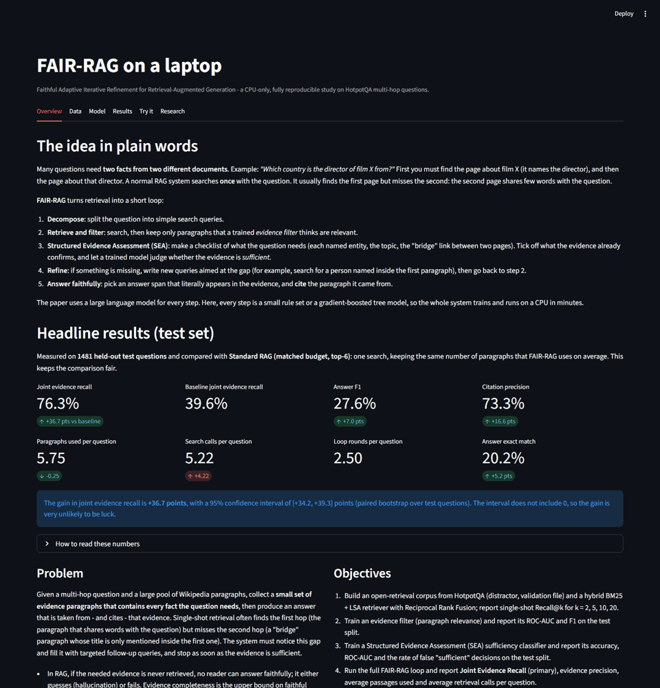
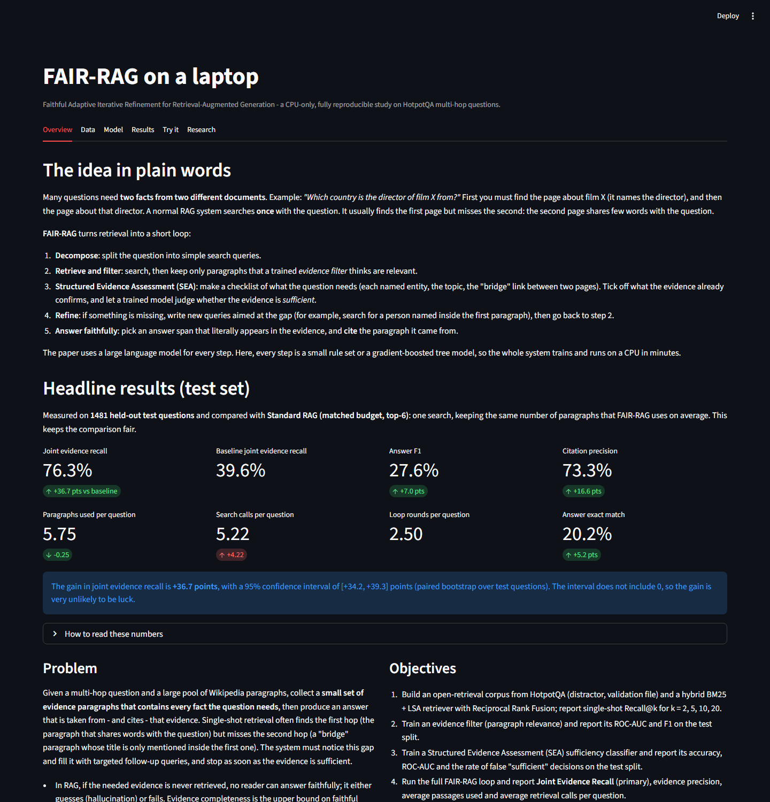
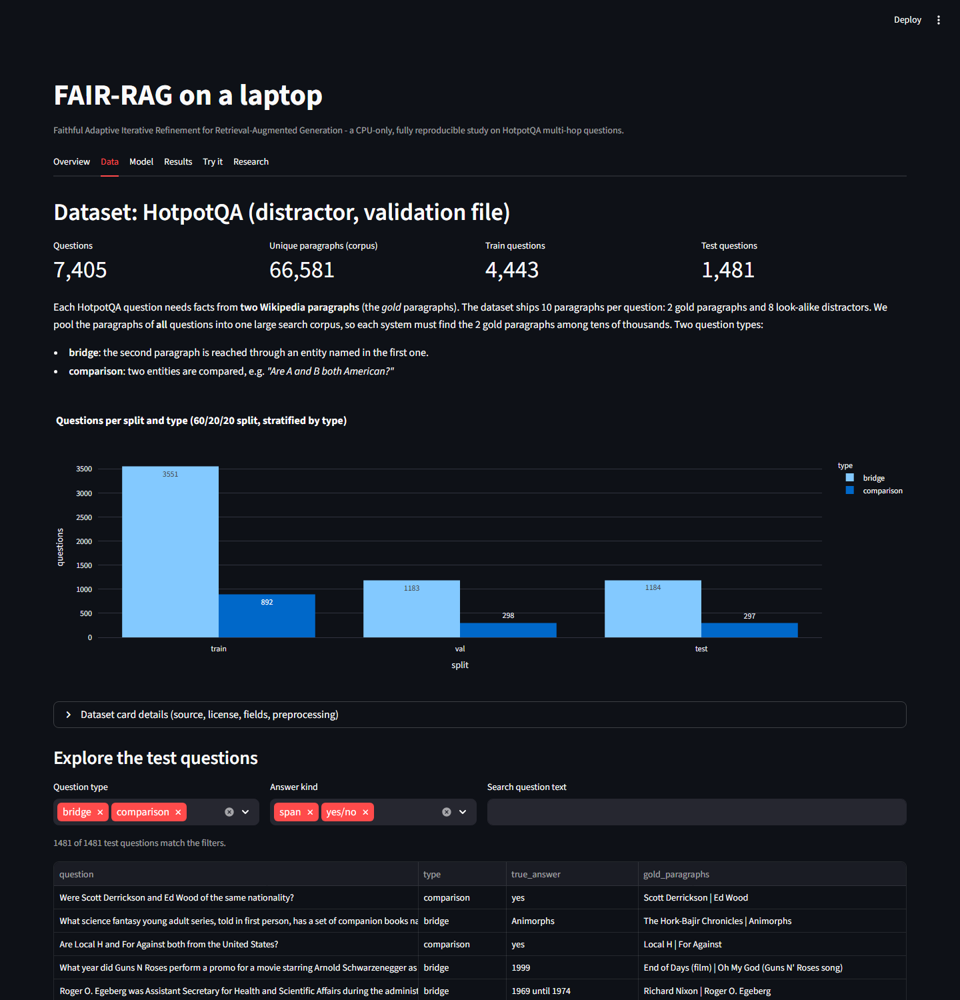
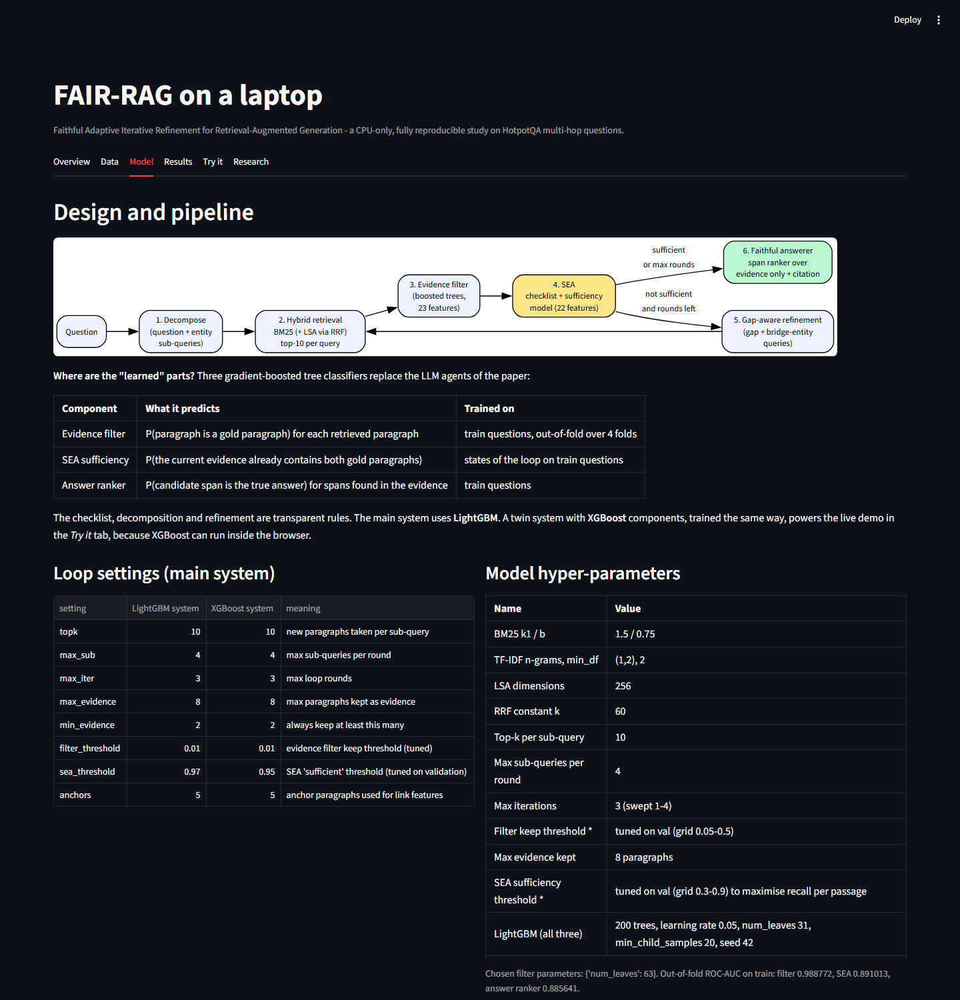
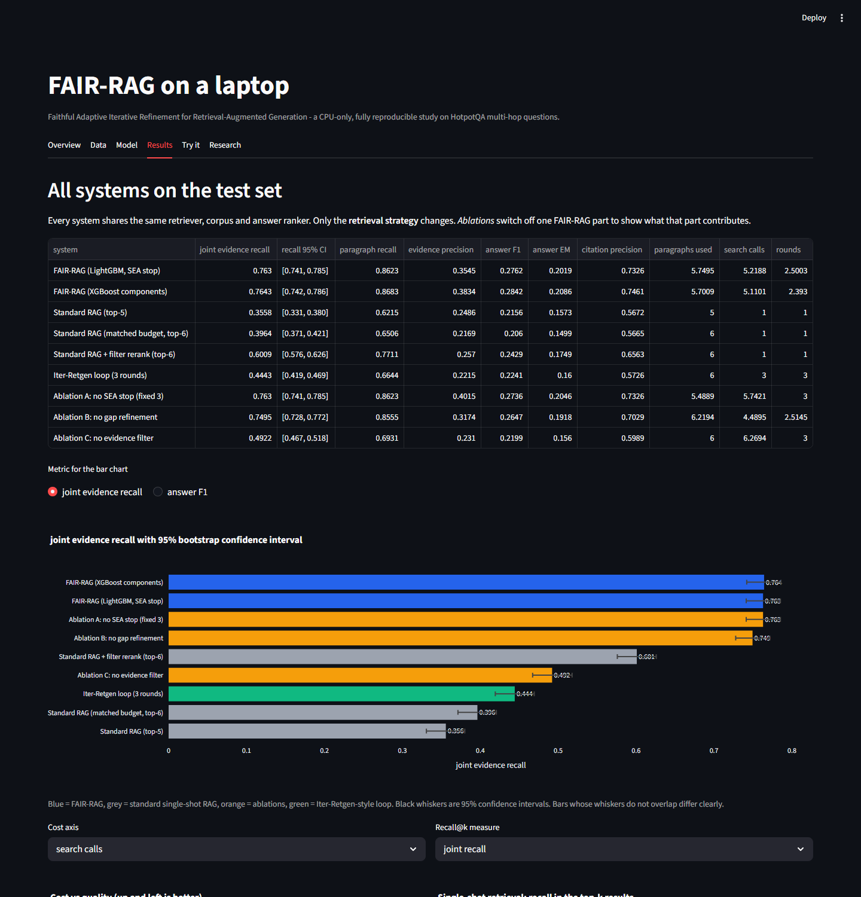
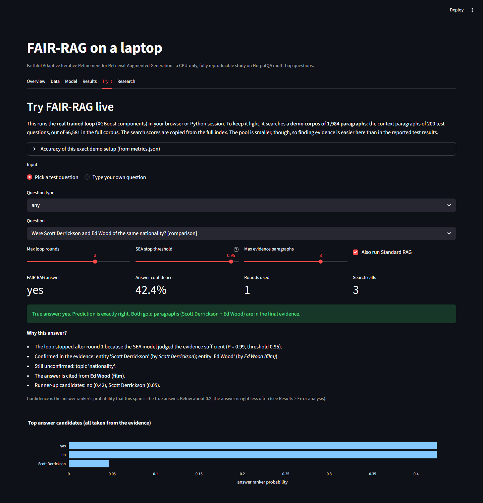
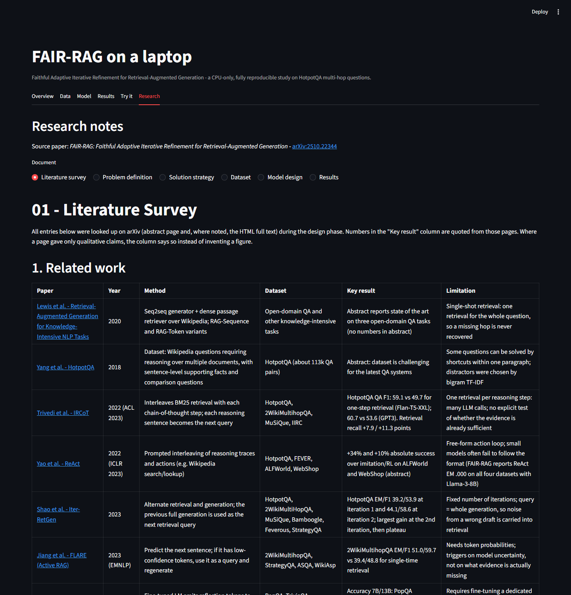
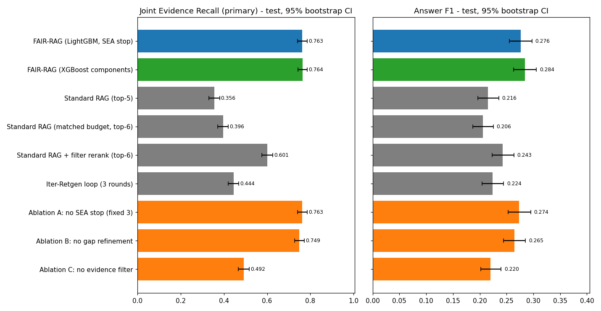
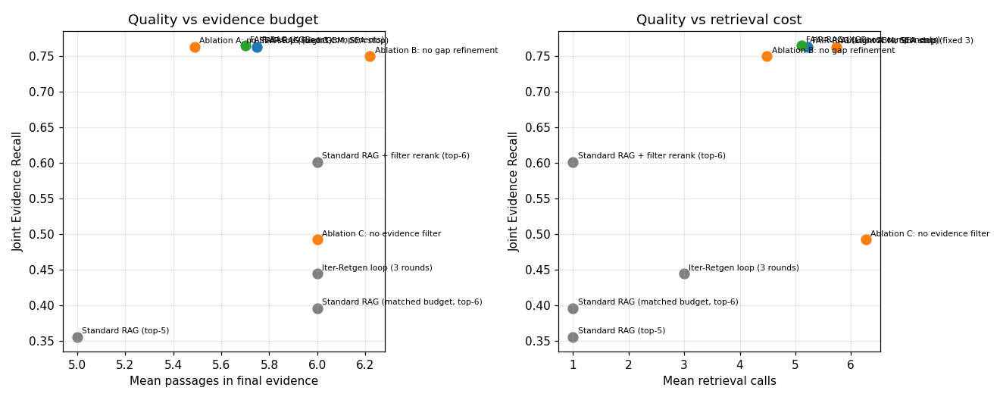
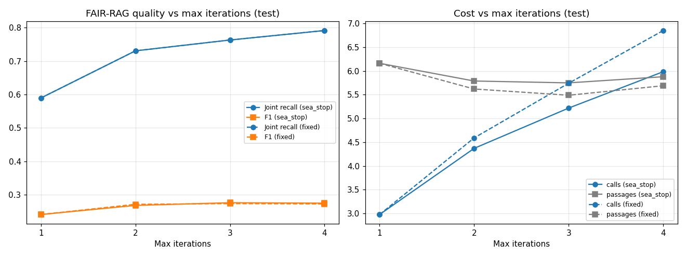

# FAIR-RAG on a Laptop: Faithful Adaptive Iterative Refinement for Multi-hop RAG

**Live dashboard:** [https://fair-rag-faithful-adaptive-iterativ.vercel.app](https://fair-rag-faithful-adaptive-iterativ.vercel.app) - the full interactive dashboard (all tabs, live predictions) running in your browser; nothing to install. The first visit takes about a minute to load.


This project rebuilds the control loop of **FAIR-RAG** (arXiv 2510.22344) - query decomposition,
evidence filtering, a *Structured Evidence Assessment* (SEA) that lists confirmed findings and
evidence gaps, gap-targeted query refinement, and faithful cited answering - without a large
language model. Each prompted module is replaced by rules or a small LightGBM / XGBoost model trained
on HotpotQA supporting-fact labels, so the whole system trains on a CPU in about 10 minutes. It is
evaluated on 1,481 held-out HotpotQA questions against a **budget-matched** standard RAG baseline,
with the ablations the original paper did not run, and everything can be explored question by
question in a Streamlit dashboard.

## Dashboard preview

Screenshots of the interactive dashboard (`streamlit run app.py`), captured automatically from the running app.



<details><summary>Every tab as a still image</summary>

**Overview**



**Data**



**Model**



**Results**



**Try It**



**Research**



</details>

## Results at a glance

Test split, 1,481 questions, open retrieval over 66,581 paragraphs. Primary metric: **Joint Evidence
Recall** = share of questions whose final evidence contains *both* gold supporting paragraphs.
Brackets are 95% bootstrap CIs. All numbers come from `artifacts/metrics.json`.

| System | Joint Evidence Recall | Answer F1 | Answer EM | Mean passages | Retrieval calls |
|---|---|---|---|---|---|
| **FAIR-RAG (LightGBM, SEA stop)** | **0.763** [0.741, 0.785] | **0.276** | 0.202 | 5.75 | 5.22 |
| Standard RAG (matched budget, top-6) - baseline | 0.396 [0.371, 0.421] | 0.206 | 0.150 | 6.00 | 1.00 |
| Standard RAG + filter rerank (top-6) | 0.601 | 0.243 | 0.175 | 6.00 | 1.00 |
| Iter-Retgen loop (3 rounds) | 0.444 | 0.224 | 0.160 | 6.00 | 3.00 |

At nearly the same number of passages, the loop finds complete evidence for **+36.7 points** more
questions (paired CI [+34.2, +39.3]). Ablations: removing the evidence filter costs 27.1 points;
removing SEA stopping keeps recall but needs 5.74 instead of 5.22 retrieval calls; gap-specific query
wording adds only +1.4 points (not significant).





## What you get

A Streamlit dashboard (`app.py`) with six tabs:

| Tab | Contents |
|---|---|
| **Overview** | The problem, the pipeline, headline numbers |
| **Data** | HotpotQA split sizes, corpus statistics, sample questions |
| **Model** | Components, hyper-parameters, feature importances, filter/SEA diagnostics |
| **Results** | All systems and ablations with CIs, iteration sweep, breakdown by type, failure taxonomy, browsable test predictions |
| **Try it** | Run the FAIR-RAG loop live on a question and step through each iteration: sub-queries, retrieved paragraphs with filter scores, SEA checklist (confirmed findings / gaps), refined queries, cited answer |
| **Research** | Source paper summary, literature survey, limitations |

## Quickstart

1. `git clone https://github.com/evanchoudhury/fair-rag-faithful-adaptive-iterative-refinement-fo-941039.git`
2. `cd fair-rag-faithful-adaptive-iterative-refinement-fo-941039`
3. Create and activate a virtual environment:
   `python -m venv .venv` then `.venv\Scripts\activate` (Windows) or `source .venv/bin/activate` (macOS/Linux)
4. `pip install -r requirements.txt`
5. `python train.py` - downloads the HotpotQA distractor validation set (about 7,405 questions)
   into `data/`, trains all components, evaluates every system and writes `artifacts/`
   (about 10 minutes on a CPU laptop; `python train.py --quick` for a fast run).
6. `streamlit run app.py` - opens the dashboard at http://localhost:8501

The trained artifacts are committed, so step 5 is optional if you only want the dashboard.
`python selfcheck.py` runs an offline end-to-end smoke test on synthetic data.

## Run with Docker

```bash
docker compose up --build
```

Then open http://localhost:8501.

## Run on Kubernetes

```bash
docker build -t fair-rag-dashboard:latest .
kubectl apply -f k8s/deployment.yaml
kubectl apply -f k8s/service.yaml
kubectl port-forward service/fair-rag-dashboard 8501:8501
```

Then open http://localhost:8501. (On a remote cluster, push the image to a registry and update
`image:` in `k8s/deployment.yaml`.) The pod is limited to 1 CPU and 1 GiB of memory.

## Project structure

```
app.py                  Streamlit dashboard
train.py                End-to-end training + evaluation + plots
selfcheck.py            Offline smoke test
src/
  data.py               HotpotQA loading, pooled corpus, splits
  text.py               Tokenisation, entity spans, EM/F1
  retriever.py          BM25 + LSA hybrid retriever with RRF
  model.py              Decomposer, evidence filter, SEA, refiner, answerer, FAIR-RAG loop
  evaluate.py           Metrics, bootstrap, failure taxonomy, plots
  demo.py, demo_export.py  Lightweight bundle for the live dashboard demo
tests/check_dashboard.py  Headless dashboard test
artifacts/              metrics.json, models, predictions, traces, plots/, demo/
docs/                   Project documentation (below)
research_paper/paper.md IEEE-style paper
Dockerfile, docker-compose.yml, k8s/   Deployment
```

## Documentation

- [01 - Literature survey](docs/01_literature_survey.md)
- [02 - Problem definition](docs/02_problem_definition.md)
- [03 - Solution strategy](docs/03_solution_strategy.md)
- [04 - Dataset](docs/04_dataset.md)
- [05 - Model design](docs/05_model_design.md)
- [06 - Results](docs/06_results.md)
- [Research paper](research_paper/paper.md)

## Source paper

M. Aghajani Asl, M. Asgari-Bidhendi, and B. Minaei-Bidgoli, "FAIR-RAG: Faithful Adaptive Iterative
Refinement for Retrieval-Augmented Generation," arXiv:2510.22344, 2025.
http://arxiv.org/abs/2510.22344

Dataset: Z. Yang et al., "HotpotQA: A Dataset for Diverse, Explainable Multi-hop Question
Answering," 2018 (Hugging Face `hotpotqa/hotpot_qa`, distractor setting).

## Limitations

- No LLM: answers are extracted spans, so answer F1 (0.276) is far below the paper's LLM-based
  numbers and is **not** directly comparable to them.
- Retrieval is over a pooled 66,581-paragraph corpus, not full Wikipedia; the LSA dense retriever
  was tuned out (fusion weight 0), so retrieval is effectively BM25.
- Components are trained and tested on splits of the HotpotQA validation set only; one seed.
- After the loop, 70.5% of failures happen with complete evidence - the answerer is the weak point.
- The live demo uses a 200-question slice; its numbers are not the test results.

See [docs/06_results.md](docs/06_results.md) for the full analysis.

## License

MIT - see [LICENSE](LICENSE).

## Container check

The Docker image was built and `selfcheck.py` passed inside the container (checked by the agent on 2026-11-19). The Kubernetes manifests were generated but not run on a cluster.
