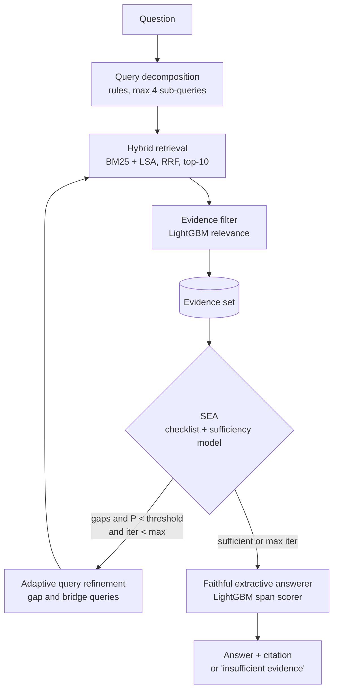

# 05 - Model Design

## Components

| # | Component (paper name) | Our implementation | Trained on |
|---|---|---|---|
| 1 | Hybrid retriever | BM25 (k1 = 1.5, b = 0.75) on unigram+bigram counts; LSA dense: TF-IDF -> TruncatedSVD(256) -> L2 norm, cosine; Reciprocal Rank Fusion (k = 60), top-10 per sub-query | Corpus text (unsupervised) |
| 2 | Query decomposition | Rules: comparison splitting ("X or Y", "both X and Y"), entity-focused sub-queries from capitalised spans/quoted titles, always include the full question; max 4 | - |
| 3 | Evidence filter | LightGBM binary classifier, ~10 features of (question, paragraph, current evidence) | Train questions, iteration-1 candidates; label = gold paragraph |
| 4 | Structured Evidence Assessment | (a) checklist builder: required findings = entities, quoted titles, numbers, content-word groups, bridge slot; (b) confirmation: finding covered by a kept paragraph; (c) LightGBM sufficiency model on evidence-state features | Train questions, states from a fixed 4-iteration run; label = both gold paragraphs kept |
| 5 | Adaptive query refinement | One query per gap: unconfirmed finding terms + question focus words; bridge queries from new entities found in confirmed paragraphs; seen paragraphs excluded | - |
| 6 | Faithful generation | Candidate spans only from kept evidence (entity spans, numbers/dates, yes/no); LightGBM scorer; answer + citation; abstain if no candidate | Train questions, final-evidence candidates; label = candidate F1 with gold >= 0.5 |

## Pipeline diagram

## Hyper-parameters (defaults; tuned ones marked *)
| Name | Value |
|---|---|
| BM25 k1 / b | 1.5 / 0.75 |
| TF-IDF n-grams, min_df | (1,2), 2 |
| LSA dimensions | 256 |
| RRF constant k | 60 |
| Top-k per sub-query | 10 |
| Max sub-queries per round | 4 |
| Max iterations | 3 (swept 1-4) |
| Filter keep threshold * | tuned on val (grid 0.05-0.5) |
| Max evidence kept | 8 paragraphs |
| SEA sufficiency threshold * | tuned on val (grid 0.3-0.9) to maximise recall per passage |
| LightGBM (all three) | 200 trees, learning rate 0.05, num_leaves 31, min_child_samples 20, seed 42 |

## Baselines and ablations (all share the same retriever and answerer)
1. **Standard RAG (top-5):** retrieve once with the question, keep top-5 (paper's setting).
2. **Standard RAG (matched budget):** same, keep top-K with K = ceil(FAIR-RAG mean evidence size). *Primary baseline.*
3. **Iter-Retgen-style loop:** 3 rounds; next query = question + text of the current top paragraph
   (stand-in for "previous generation"); no filter model, no SEA; top-K evidence at the end.
4. **Ablation A - no SEA stopping:** full FAIR-RAG but always runs max iterations.
5. **Ablation B - no gap-aware refinement:** SEA stopping kept, but refinement uses the
   Iter-Retgen whole-text query instead of gap/bridge queries.
6. **Ablation C - no evidence filter:** keep top passages by fused rank only.

## Evaluation protocol
- Test split only (~1,481 questions), one run, seed 42.
- **Primary:** Joint Evidence Recall (both gold paragraphs in final evidence).
- Retrieval: Gold-paragraph recall (per paragraph), evidence precision, mean passages used,
  mean retrieval calls, Recall@k curve for single-shot retrieval.
- Answer: EM, F1 (HotpotQA normalisation), citation precision (cited paragraph is gold),
  abstention rate.
- Components: filter ROC-AUC / F1; SEA accuracy, ROC-AUC, false-sufficient rate.
- Statistics: paired bootstrap (2,000 resamples) 95% CI for the difference in Joint Evidence
  Recall and F1 between FAIR-RAG and each baseline.
- Breakdowns: question type (bridge / comparison), level (easy / medium / hard).
- Iteration sweep: max iterations 1-4 -> recall, F1, calls.
- Failure taxonomy per test question: retrieval miss (gold never retrieved), filter drop
  (retrieved but discarded), early stop (SEA said sufficient while a gold paragraph was missing),
  answer error (evidence complete but answer wrong), correct.
- Wall-clock training and evaluation time recorded in `artifacts/metrics.json`.
