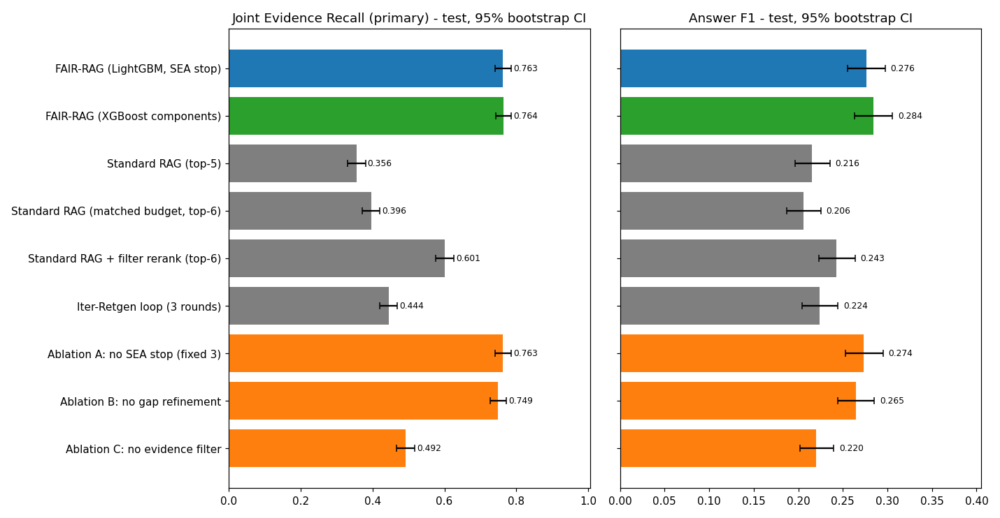
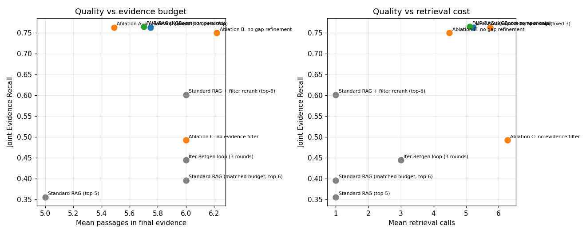
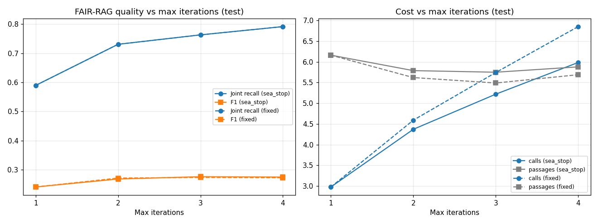
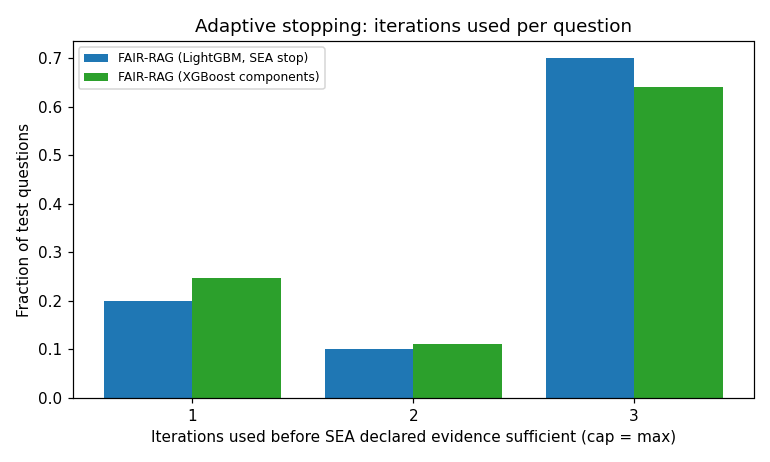
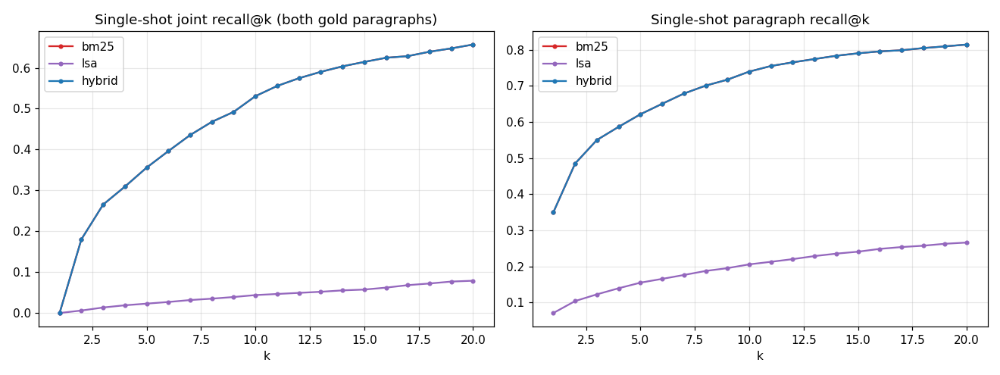
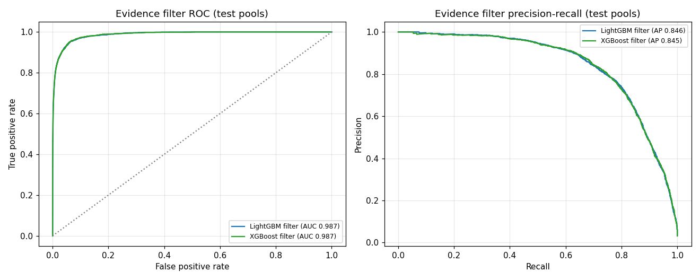
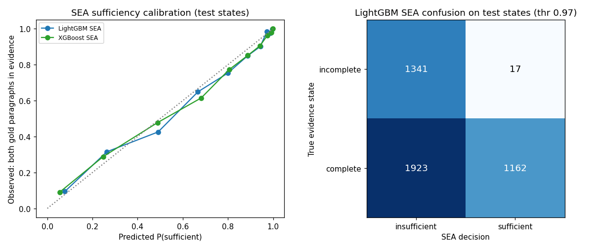
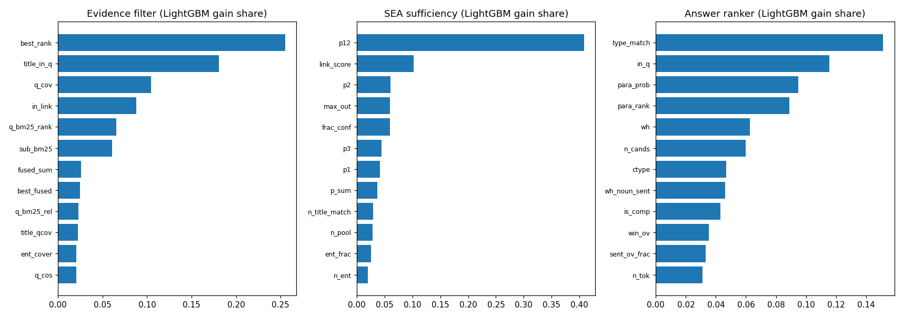
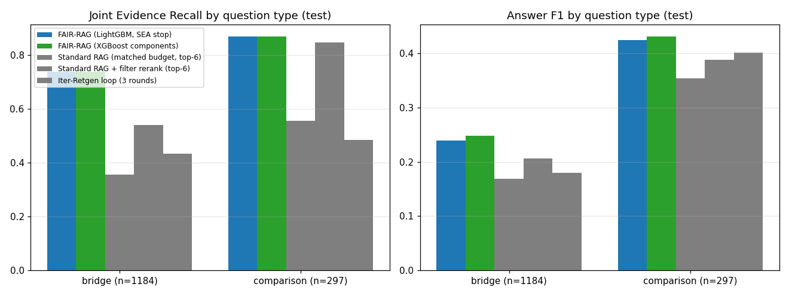
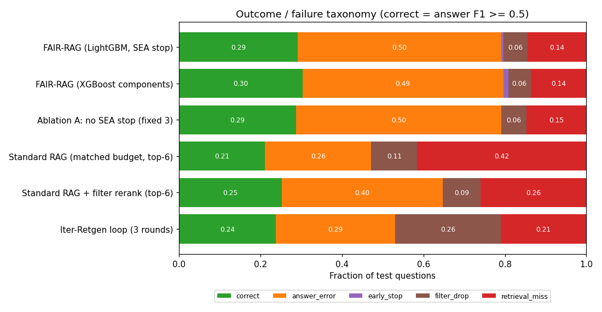

# 06 - Results

Every number on this page is copied from `artifacts/metrics.json` or `artifacts/sample_predictions.csv`,
written by one run of `python train.py` (full mode, seed 42, wall-clock 583.9 s on a CPU laptop).
Evaluation is on the held-out **test split: 1,481 HotpotQA questions** (1,184 bridge, 297 comparison),
retrieving from a pooled open corpus of **66,581 paragraphs**. Square brackets are 95% bootstrap
confidence intervals.

## 1. Main result

| System | Joint Evidence Recall (primary) | Paragraph recall | Evidence precision | Answer EM | Answer F1 | Citation precision | Mean passages | Mean retrieval calls |
|---|---|---|---|---|---|---|---|---|
| **FAIR-RAG (LightGBM, SEA stop)** - main model | **0.763** [0.741, 0.785] | 0.862 | 0.355 | 0.202 | 0.276 [0.255, 0.298] | 0.733 | 5.75 | 5.22 |
| FAIR-RAG (XGBoost components) | 0.764 [0.742, 0.786] | 0.868 | 0.383 | 0.209 | 0.284 [0.263, 0.306] | 0.746 | 5.70 | 5.11 |
| **Standard RAG (matched budget, top-6)** - primary baseline | **0.396** [0.371, 0.421] | 0.651 | 0.217 | 0.150 | 0.206 [0.187, 0.225] | 0.567 | 6.00 | 1.00 |
| Standard RAG (top-5, the paper's setting) | 0.356 [0.331, 0.380] | 0.622 | 0.249 | 0.157 | 0.216 [0.196, 0.235] | 0.567 | 5.00 | 1.00 |
| Standard RAG + filter rerank (top-6) | 0.601 [0.576, 0.626] | 0.771 | 0.257 | 0.175 | 0.243 [0.223, 0.264] | 0.656 | 6.00 | 1.00 |
| Iter-Retgen loop (3 rounds) | 0.444 [0.419, 0.469] | 0.664 | 0.221 | 0.160 | 0.224 [0.205, 0.244] | 0.573 | 6.00 | 3.00 |

**Headline:** with almost the same number of passages (5.75 vs 6.00), FAIR-RAG collects *both* gold
supporting paragraphs for **76.3%** of test questions, against **39.6%** for budget-matched Standard
RAG - a paired difference of **+36.7 points [+34.2, +39.3]** (bootstrap p(diff <= 0) = 0.0). Answer F1
rises from 0.206 to 0.276 (**+7.0 points [+5.3, +8.8]**).

Joint Evidence Recall is the primary metric because it measures exactly what the Structured Evidence
Assessment (SEA) is designed to guarantee: that *all* required evidence has been found.
"Abstain rate" was 0.0 for every system (the answerer always found at least one candidate span).

### Paired bootstrap: main model minus each comparison system

| Comparison system | Diff. joint recall [95% CI] | p(diff <= 0) | Diff. answer F1 [95% CI] | p(diff <= 0) |
|---|---|---|---|---|
| Standard RAG (matched budget, top-6) | +0.367 [+0.342, +0.393] | 0.000 | +0.070 [+0.053, +0.088] | 0.000 |
| Standard RAG (top-5) | +0.407 [+0.382, +0.432] | 0.000 | +0.061 [+0.043, +0.079] | 0.000 |
| Standard RAG + filter rerank (top-6) | +0.162 [+0.140, +0.184] | 0.000 | +0.033 [+0.018, +0.050] | 0.000 |
| Iter-Retgen loop (3 rounds) | +0.319 [+0.293, +0.344] | 0.000 | +0.052 [+0.035, +0.070] | 0.000 |
| FAIR-RAG (XGBoost components) | -0.001 [-0.010, +0.007] | 0.632 | -0.008 [-0.025, +0.010] | 0.823 |

The LightGBM and XGBoost versions of the pipeline are statistically indistinguishable; the
dashboard's live demo uses the XGBoost components.

*Joint Evidence Recall and answer F1 with 95% CIs for every system.* The gap between the two
FAIR-RAG variants and every single-shot or Iter-Retgen baseline is far larger than the error bars.
The F1 gains are much smaller than the evidence gains - see the error analysis below.

## 2. Ablations: which part of the loop matters?

The source paper did not run a fixed-loop ablation (see `01_literature_survey.md`). We did.

| Variant | Joint recall | Answer F1 | Evidence precision | Mean passages | Mean calls | Mean iterations | Diff. joint vs main [95% CI] |
|---|---|---|---|---|---|---|---|
| Main model (SEA stop, gap refinement, filter) | 0.763 | 0.276 | 0.355 | 5.75 | 5.22 | 2.50 | - |
| A: no SEA stop (always 3 iterations) | 0.763 | 0.274 | 0.401 | 5.49 | 5.74 | 3.00 | 0.000 [0.000, 0.000] |
| B: no gap refinement (Iter-Retgen-style re-query) | 0.749 | 0.265 | 0.317 | 6.22 | 4.49 | 2.51 | +0.014 [-0.006, +0.032] |
| C: no evidence filter | 0.492 | 0.220 | 0.231 | 6.00 | 6.27 | 3.00 | +0.271 [+0.246, +0.294] |

What the ablations show:

- **The evidence filter is the largest single contributor** (removing it costs 27.1 points of joint
  recall). Even a single-shot retriever with the filter as a reranker (0.601) beats the Iter-Retgen loop
  (0.444).
- **SEA early stopping is free in recall but saves cost.** Ablation A reaches exactly the same joint
  recall (0.763) but uses 5.74 retrieval calls per question instead of 5.22 (about 9% more) and
  3.00 iterations instead of 2.50. SEA stopped after the first iteration for 296 questions and after
  the second for 148; 1,037 used all three. The fixed loop does end with slightly *higher* evidence
  precision (0.401 vs 0.355) because the extra rounds give the filter more chances to replace weak
  passages - a trade-off we did not expect.
- **Gap-targeted refinement gives a small, not clearly significant gain** in recall (+1.4 points, CI
  crosses zero, p = 0.10) and a borderline F1 gain (+1.2 points [-0.04, +2.3], p = 0.032), while using
  *more* retrieval calls (5.22 vs 4.49) but fewer passages (5.75 vs 6.22). On this setup most of the
  benefit comes from decomposition + filtering + multiple rounds, not from the specific wording of the
  refined queries.

*Joint recall against passages used (left) and retrieval calls (right).* All FAIR-RAG variants sit in
the top band (0.75-0.76) at about 5.5-6.2 passages. Standard RAG at the same passage budget sits at
0.40. This rules out "FAIR-RAG only wins because it reads more passages", one of the main weaknesses
we identified in the source paper. It does use more retrieval *calls* (about 5 vs 1).

## 3. Iteration sweep

| Max iterations | Joint recall (SEA stop) | Joint recall (fixed) | F1 (SEA stop) | F1 (fixed) | Calls (SEA stop) | Calls (fixed) | Mean iterations used (SEA stop) |
|---|---|---|---|---|---|---|---|
| 1 | 0.589 | 0.589 | 0.241 | 0.241 | 2.98 | 2.98 | 1.00 |
| 2 | 0.731 | 0.731 | 0.268 | 0.271 | 4.37 | 4.59 | 1.80 |
| 3 (default) | 0.763 | 0.763 | 0.276 | 0.274 | 5.22 | 5.74 | 2.50 |
| 4 | 0.791 | 0.791 | 0.275 | 0.273 | 5.99 | 6.85 | 3.16 |

*Quality (left) and cost (right) as the iteration cap grows.* The biggest step is from 1 to 2
iterations (+14.2 points), matching the paper's and Iter-RetGen's observation that the second round
matters most. Unlike the paper, recall keeps rising at 4 iterations (+2.8 points over 3), but answer
F1 has already flattened (0.276 -> 0.275), and the SEA-stop line saves more calls the higher the cap.

*How many iterations SEA allowed per test question* (cap 3): 296 stopped after 1, 148 after 2,
1,037 ran to the cap. The SEA threshold (0.97) was tuned on validation for recall per call, so it is
deliberately conservative.

## 4. Retrieval

*Single-shot recall@k of the question as a query.* BM25 reaches joint recall 0.396 at k = 6 and only
0.657 at k = 20 - i.e. even reading 20 passages, single-shot retrieval finds both gold paragraphs less
often than FAIR-RAG does with about 6. The LSA "dense" retriever is very weak here (joint 0.044 at
k = 10). On the training split, adding any LSA weight to Reciprocal Rank Fusion lowered paragraph
recall@10 (0.738 at weight 0 vs 0.538 at weight 1.0), so the tuned fusion weight was **0.0** and the
"hybrid" retriever is in practice BM25 only. The hybrid curve therefore overlaps the BM25 curve.

## 5. Components

| Component | n (test rows) | ROC-AUC | Avg. precision | Threshold | Precision | Recall | F1 | Accuracy |
|---|---|---|---|---|---|---|---|---|
| Evidence filter (LightGBM) | 83,359 | 0.987 | 0.846 | 0.01 | 0.279 | 0.962 | 0.433 | 0.919 |
| Evidence filter (XGBoost) | 83,359 | 0.987 | 0.845 | 0.01 | 0.263 | 0.968 | 0.414 | 0.912 |
| SEA sufficiency (LightGBM) | 4,443 | 0.891 | 0.948 | 0.97 | 0.986 | 0.377 | 0.545 | 0.563 |
| SEA sufficiency (XGBoost) | 4,443 | 0.891 | 0.948 | 0.95 | 0.975 | 0.466 | 0.631 | 0.621 |

Answerer: F1 0.324 and EM 0.237 *when the evidence is complete*; the correct answer is among its
candidate spans for 81.9% of questions (candidate recall 0.819).

*Evidence filter ROC and precision-recall curves.* Ranking quality is high (ROC-AUC 0.987), but only
3.2% of candidates are gold, so the tuned threshold (0.01) keeps almost every gold paragraph
(recall 0.962) at low precision (0.279). The threshold was chosen on validation to maximise joint
recall per passage, not filter F1.

*SEA calibration (left) and confusion matrix at threshold 0.97 (right).* The probabilities are well
calibrated. At 0.97 the model says "sufficient" only 1,179 times and is wrong in 17 of them
(false-sufficient rate 1.4%); the cost is that it calls 1,923 complete states "insufficient", which
only means one more (cheap) retrieval round. Its accuracy (0.563) is therefore low by design.

*Normalised feature importance (LightGBM gain).* The filter relies most on the paragraph's best
retrieval rank (0.255) and on whether its title appears in the question (0.181). SEA is dominated by
`p12` (0.409) - the product of the two highest filter scores, i.e. "do I already have two strong
paragraphs?" - followed by `link_score` (0.102), whether kept paragraphs link to each other. The
answer ranker leans on answer-type matching (`type_match`, 0.151) and on not repeating question words
(`in_q`, 0.116).

## 6. Breakdown by question type

| System | Bridge joint (n=1,184) | Bridge F1 | Comparison joint (n=297) | Comparison F1 |
|---|---|---|---|---|
| FAIR-RAG (LightGBM) | 0.736 | 0.239 | 0.869 | 0.423 |
| FAIR-RAG (XGBoost) | 0.738 | 0.247 | 0.869 | 0.431 |
| Standard RAG (matched, top-6) | 0.356 | 0.169 | 0.556 | 0.354 |
| Standard RAG + filter rerank | 0.540 | 0.207 | 0.845 | 0.388 |
| Iter-Retgen loop | 0.434 | 0.180 | 0.485 | 0.401 |

*Bridge questions gain the most* (0.356 -> 0.736 joint recall, more than double), because the second
paragraph is often only reachable through an entity found in the first one - exactly what gap and
bridge queries target. Comparison questions name both entities, so a filter rerank alone already gets
0.845; iteration adds only 2.4 more points there.

## 7. Error analysis

The failure taxonomy classifies each test question (correct = answer F1 >= 0.5):

| System | Correct | Answer error (evidence complete) | Early stop by SEA | Filter dropped gold | Retrieval miss |
|---|---|---|---|---|---|
| FAIR-RAG (LightGBM) | 0.292 | 0.500 | 0.005 | 0.059 | 0.144 |
| FAIR-RAG (XGBoost) | 0.303 | 0.493 | 0.012 | 0.055 | 0.136 |
| Ablation A (fixed 3) | 0.287 | 0.504 | 0.000 | 0.061 | 0.147 |
| Standard RAG (matched) | 0.211 | 0.261 | 0.000 | 0.113 | 0.415 |
| Standard RAG + filter rerank | 0.253 | 0.395 | 0.000 | 0.093 | 0.260 |
| Iter-Retgen loop | 0.237 | 0.293 | 0.000 | 0.260 | 0.210 |

- **The bottleneck has moved from retrieval to reading.** For Standard RAG, 52.7% of its failures
  are retrieval misses; for FAIR-RAG, 70.5% of failures happen *with complete evidence* (740 of the
  1,049 failed test questions in `sample_predictions.csv`). The extractive LightGBM answerer is the
  weakest part of the system: F1 is only 0.324 even when both gold paragraphs are present.
- **SEA almost never stops too early** (7 questions, 0.5%). In the paper SEA caused 24.5% of
  errors; our conservative threshold trades this for extra calls.
- **Retrieval misses** (214 questions) are mostly cases where the question's wording shares few words
  with the second paragraph. Example from the test set: *"What race track in the midwest hosts a 500
  mile race eavery May?"* - gold *Indianapolis Motor Speedway*; BM25 has no way to map "midwest" or
  the misspelled "eavery" to it, and the system answered *Saratoga Race Course*.
- **Answer errors** are typically type mismatches inside correct evidence: for *"What year did Guns N
  Roses perform a promo for a movie starring Arnold Schwarzenegger..."* both gold paragraphs were
  found, but the answerer picked the date *"October 30, 1957"* instead of *1999*.
- **Lucky answers exist**: for *"Are Local H and For Against both from the United States?"* the
  system answered "yes" correctly with joint recall 0 - yes/no questions can be right without
  evidence, which is why we report evidence recall separately from F1.
- A clean win: for the Animorphs question (*"What science fantasy young adult series, told in first
  person..."*) Standard RAG missed one gold paragraph (joint 0) while FAIR-RAG found both in three
  iterations and cited *Animorphs* correctly.

## 8. Comparison with the source paper

| Quantity | Source paper (FAIR-RAG, arXiv 2510.22344) | This project | Comparable? |
|---|---|---|---|
| HotpotQA answer F1, FAIR-RAG (3 iterations) | .447 | 0.276 | **No** - see differences below |
| HotpotQA answer F1, Standard RAG | .342 | 0.216 (top-5) | **No** |
| Relative F1 gain over Standard RAG | .447 / .342 (about +31%) | 0.276 / 0.216 (about +28%) | Direction only |
| Iter-Retgen F1 | .370 | 0.224 | **No** |
| Evidence filter F1 | 67.3% | 43.3% (threshold tuned for recall) | Different operating point |
| SEA accuracy | 72.0% | 56.3% (threshold 0.97, precision 0.986) | Different operating point |
| Best iteration count | 2-3, worse at 4 | Recall still rising at 4; F1 flat after 3 | Partly |
| Share of errors from SEA | 24.5% | 0.7% (early stop) | Different taxonomy |
| Share of errors from retrieval | 32.5% | 20.4% retrieval miss + 8.4% filter drop | Different taxonomy |
| Share of errors from generation | 31.0% | 70.5% | Different taxonomy |

**Setup differences (why absolute numbers are not comparable):**
1. **No LLM.** The paper uses Llama-3-8B-Instruct prompts for every module. We replace them with
   rules and small gradient-boosted models trained on HotpotQA supporting-fact labels, and an
   *extractive* answerer. Our answer F1 is therefore much lower in absolute terms.
2. **Different corpus.** The paper retrieves from DPR Wikipedia (about 21M passages) with dense
   e5-base-v2. We retrieve from a pooled corpus of the 66,581 paragraphs that appear in HotpotQA
   distractor-validation contexts, with BM25 (LSA got weight 0).
3. **Different test set.** The paper samples 1,000 questions; we use our own 20% split (1,481
   questions) of the HotpotQA distractor validation set, and the models are trained on another 60%
   of that same set.
4. **We add what the paper lacked:** a budget-matched baseline, fixed-loop and no-refinement
   ablations, and paired bootstrap confidence intervals.

**What does carry over:** the *direction* of the claims. An iterative, filtered, sufficiency-checked
loop collects far more of the required evidence than single-shot retrieval at the same passage
budget, the second iteration matters most, and an explicit sufficiency check saves retrieval calls
without losing recall. What we could **not** confirm is that the gap-aware query wording itself is a
major source of gains: in our ablation its contribution is small and not significant for recall.

## 9. Limitations

- No generative LLM; answers are extractive spans, so F1 is far below LLM-based systems.
- Closed pooled corpus (66,581 paragraphs) - much easier than open Wikipedia; distractors come from
  HotpotQA's own TF-IDF-chosen contexts.
- The trained components learn from HotpotQA supporting-fact labels; transfer to other datasets
  (2WikiMultiHopQA, MuSiQue) was not tested.
- The dense part of the "hybrid" retriever (LSA) did not help and was switched off by tuning, so the
  hybrid-retrieval claim of the paper is not tested here.
- One run, one seed; CIs reflect test-set sampling, not training randomness.
- Query decomposition and gap refinement are rule-based and English-specific.
- The dashboard demo uses a 200-question / 1,984-paragraph slice; its numbers (joint recall 0.875 vs
  0.430) are on that easier slice and must not be compared with the test results above.

## 10. Future work

- Replace the extractive answerer with a small local generator (the main remaining error source).
- A real dense retriever (e.g. a small sentence encoder) to fix vocabulary-mismatch retrieval misses.
- Evaluate on 2WikiMultiHopQA and MuSiQue, and on a full Wikipedia index.
- Learn the stopping threshold per question type, and try a cost-aware stopping objective.
- Repeat training with several seeds to report training variance.
