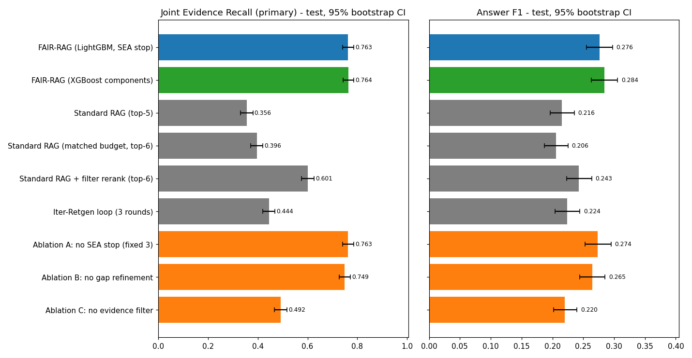
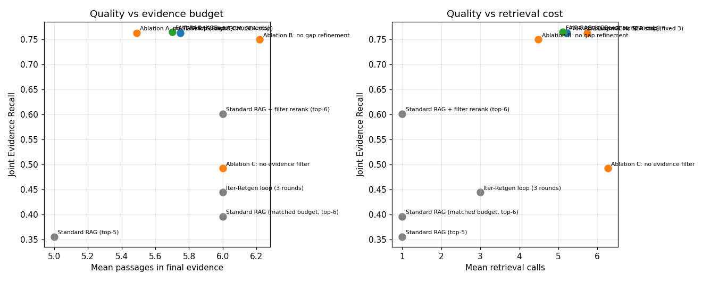
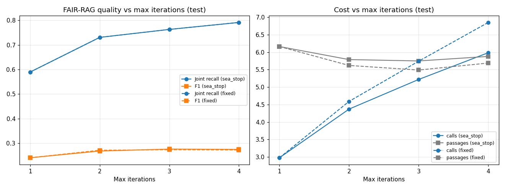
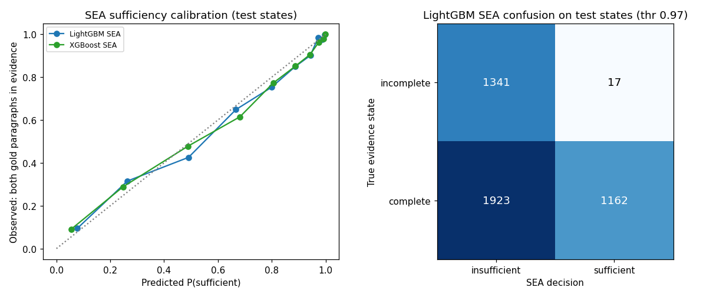
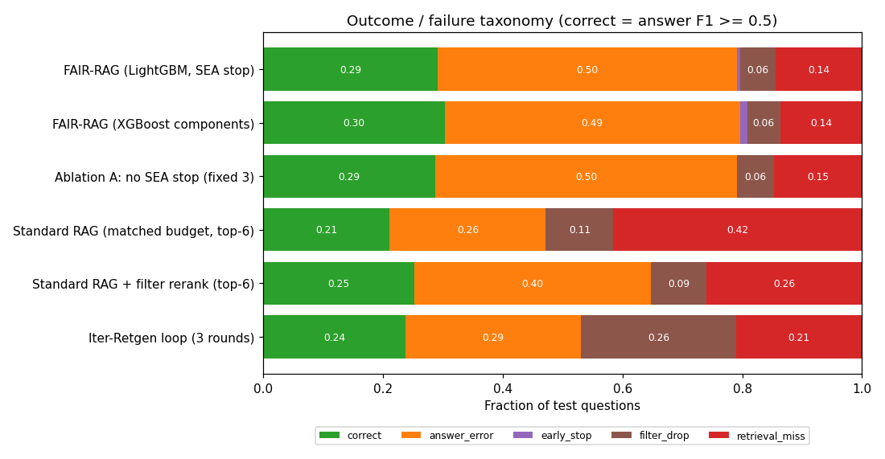

# Evidence Gaps on a Laptop: A Budget-Matched, Ablated Reproduction of the FAIR-RAG Control Loop with Lightweight Learned Components

*Repository owner* - independent reproduction study, 2026

## Abstract

Retrieval-augmented generation (RAG) struggles on multi-hop questions because a single retrieval
round rarely surfaces every required document. FAIR-RAG addresses this with an iterative loop of
query decomposition, evidence filtering, a Structured Evidence Assessment (SEA) that lists confirmed
findings and gaps, and gap-targeted query refinement. Its published evaluation, however, compares
systems that read different numbers of passages and contains no ablation of the loop itself. We
reimplement the FAIR-RAG control logic without a large language model: each prompted module is
replaced by rules or a small gradient-boosted classifier trained on HotpotQA supporting-fact labels,
and the whole system trains in under ten minutes on a CPU. On 1,481 held-out HotpotQA questions
retrieved from a 66,581-paragraph corpus, the loop collects both gold supporting paragraphs for
76.3% of questions, compared with 39.6% for standard RAG at a matched budget of six passages
(paired difference +36.7 points, 95% CI [+34.2, +39.3]); extractive answer F1 rises from 0.206 to
0.276. Ablations show that the evidence filter contributes most (removing it costs 27.1 points), SEA
early stopping preserves recall while cutting retrieval calls from 5.74 to 5.22, and gap-specific
query wording adds only 1.4 points, which is not statistically significant. The bottleneck shifts
from retrieval to reading: 70.5% of remaining failures occur with complete evidence. Code, trained
models, and an interactive dashboard are released.

**Index Terms** - retrieval-augmented generation, multi-hop question answering, iterative retrieval,
evidence sufficiency, HotpotQA, gradient boosting, ablation study.

## I. Introduction

Retrieval-augmented generation [1] grounds a language model in retrieved documents, reducing
hallucination and knowledge staleness. Multi-hop questions such as those in HotpotQA [2] require
combining facts from two or more documents, and the second document is often only reachable through
an entity mentioned in the first. Single-shot retrieval with the original question therefore misses
required evidence, and no amount of careful reading can recover it.

A line of work makes retrieval iterative: interleaving retrieval with chain-of-thought steps [3],
reasoning-action loops [4], retrieval conditioned on the previous generation [5], or retrieval
triggered by model uncertainty [6], [10]. FAIR-RAG [11] argues that these methods lack an explicit
check of *which* evidence is still missing. Its SEA module converts the question into a checklist of
required findings, audits the collected evidence against it, and either declares the evidence
sufficient or emits targeted queries for the gaps.

FAIR-RAG reports clear gains in answer F1, but (i) its baselines read fewer passages than the full
loop, (ii) there is no fixed-loop or no-refinement ablation, so the source of the gain is unclear,
and (iii) no confidence intervals are given. This paper contributes:

1. A laptop-scale reimplementation of the full FAIR-RAG control loop with transparent, trained
   components and per-iteration traces.
2. An evidence-level primary metric, *Joint Evidence Recall*, which measures directly what SEA is
   meant to guarantee.
3. A budget-matched baseline, three ablations, an iteration sweep, and paired bootstrap tests.

## II. Related Work

**Single-shot RAG.** Lewis et al. [1] couple a dense passage retriever with a seq2seq generator and
retrieve once per question; a missing hop cannot be recovered. HotpotQA [2] provides multi-hop
questions with sentence-level supporting facts, which we use as supervision and as ground truth for
evidence recall.

**Iterative retrieval.** IRCoT [3] uses each chain-of-thought sentence as the next BM25 query and
reports HotpotQA F1 of 59.1 vs 49.7 for one-step retrieval with Flan-T5-XXL. ReAct [4] interleaves
reasoning traces with search actions. Iter-RetGen [5] feeds the whole previous generation back as
the next query, with the largest gain at the second iteration (HotpotQA EM/F1 39.2/53.9 to
44.1/58.6). Because the query is the whole draft, errors in the draft propagate into retrieval.

**Adaptive retrieval.** FLARE [6] retrieves when the next sentence contains low-confidence tokens;
DRAGIN [10] uses the model's real-time information needs. Both trigger on model uncertainty rather
than on missing evidence. Adaptive-RAG [8] routes each query once, before retrieval, by predicted
complexity.

**Self-critique and verification.** Self-RAG [7] fine-tunes a model to emit reflection tokens that
critique passages and outputs. SuRe [9] summarises evidence per answer candidate and verifies it,
but within a single retrieval round.

**FAIR-RAG.** FAIR-RAG [11] combines decomposition, filtering, SEA and gap-driven refinement with
Llama-3-8B-Instruct prompts, reporting HotpotQA F1 .447 vs .342 for standard RAG and .370 for
Iter-RetGen. Our study tests its control logic under controlled budgets.

## III. Methodology

The pipeline (Fig. 1 in `docs/05_model_design.md`) runs up to $T = 3$ iterations.

**A. Retrieval.** BM25 ($k_1 = 1.5$, $b = 0.75$) over unigram+bigram counts, fused by Reciprocal
Rank Fusion ($k = 60$) with an LSA retriever (TF-IDF, 256-dimensional truncated SVD). The fusion
weight of LSA was tuned on training questions; every non-zero weight lowered paragraph recall@10
(0.738 at weight 0 vs 0.538 at weight 1.0), so the selected weight is 0 and retrieval is effectively
BM25. Each sub-query returns its top 10 paragraphs; already-seen paragraphs are excluded.

**B. Query decomposition.** Rules produce at most four sub-queries: the full question, comparison
splits ("X or Y", "both X and Y"), and entity-focused queries from capitalised or quoted spans.

**C. Evidence filter.** A LightGBM classifier scores each (question, paragraph, evidence-state) pair
using retrieval ranks and scores, query coverage, title-in-question, entity coverage and hyperlink
features. Paragraphs above threshold $\tau$ are kept (at most eight).

**D. Structured Evidence Assessment.** A rule-based checklist extracts required findings (entities,
quoted titles, numbers, content-word groups, and a bridge slot). A finding is *confirmed* if a kept
paragraph covers it. A LightGBM sufficiency model estimates $P(\text{both gold paragraphs kept})$
from evidence-state features (top filter scores, confirmed fraction, link score, iteration, number of
calls). The loop stops when $P \ge \theta$.

**E. Adaptive query refinement.** For each unconfirmed finding a new query is formed from its terms
plus the question's focus words; bridge queries are formed from new entities in confirmed
paragraphs.

**F. Faithful answering.** Candidate spans (entities, numbers, dates, yes/no) are drawn *only* from
kept evidence and ranked by a LightGBM scorer; the answer is returned with a citation to its source
paragraph, or the system abstains if no candidate exists.

**G. Training.** Filter labels are gold-paragraph membership; SEA labels are whether both gold
paragraphs are in the evidence state (states from a fixed four-iteration run on training questions);
answer labels are candidate F1 >= 0.5 against the gold answer. A parallel XGBoost version of all
three components is trained for comparison. $\tau$ and $\theta$ are selected on the validation split
to maximise joint recall per passage and per retrieval call respectively.

## IV. Experimental Setup

**Data.** The HotpotQA distractor validation set (7,405 questions) is split 60/20/20 by question,
stratified by type (seed 42): 4,443 train, 1,481 validation, 1,481 test (1,184 bridge, 297
comparison). All context paragraphs are pooled and deduplicated by title into an open corpus of
66,581 paragraphs, so each system must find the gold paragraphs among all of them.

**Systems.** (1) Standard RAG, top-5 (the paper's setting); (2) Standard RAG at a matched budget
of top-6, where 6 is the ceiling of FAIR-RAG's mean evidence size - our primary baseline;
(3) Standard RAG with the trained filter as a reranker; (4) an Iter-RetGen-style loop of three
rounds; (5) FAIR-RAG with LightGBM components (main model, $\tau = 0.01$, $\theta = 0.97$);
(6) FAIR-RAG with XGBoost components ($\theta = 0.95$); and ablations A (no SEA stop), B (whole-text
re-query instead of gap refinement) and C (no filter). All share the same retriever and answerer.

**Metrics.** Primary: Joint Evidence Recall - the fraction of questions whose final evidence
contains both gold supporting paragraphs. Secondary: paragraph recall, evidence precision, answer
EM/F1 (HotpotQA normalisation), citation precision, mean passages, mean retrieval calls. Paired
bootstrap with 2,000 resamples gives 95% CIs.

**Compute.** Full training and evaluation took 583.9 s on a CPU-only Windows laptop with 16 GB RAM.

## V. Results

**TABLE I. Test-set results (n = 1,481). Brackets: 95% bootstrap CI.**

| System | Joint recall | Answer F1 | EM | Cit. prec. | Passages | Calls |
|---|---|---|---|---|---|---|
| Standard RAG (top-5) | 0.356 [0.331, 0.380] | 0.216 | 0.157 | 0.567 | 5.00 | 1.00 |
| Standard RAG (matched, top-6) | 0.396 [0.371, 0.421] | 0.206 | 0.150 | 0.567 | 6.00 | 1.00 |
| Standard RAG + filter rerank | 0.601 [0.576, 0.626] | 0.243 | 0.175 | 0.656 | 6.00 | 1.00 |
| Iter-RetGen loop (3 rounds) | 0.444 [0.419, 0.469] | 0.224 | 0.160 | 0.573 | 6.00 | 3.00 |
| **FAIR-RAG (LightGBM)** | **0.763 [0.741, 0.785]** | **0.276** | 0.202 | 0.733 | 5.75 | 5.22 |
| FAIR-RAG (XGBoost) | 0.764 [0.742, 0.786] | 0.284 | 0.209 | 0.746 | 5.70 | 5.11 |

Against the matched-budget baseline the paired difference is +0.367 [+0.342, +0.393] in joint
recall and +0.070 [+0.053, +0.088] in F1; against the filter-rerank baseline it is +0.162
[+0.140, +0.184] and +0.033 [+0.018, +0.050]. The LightGBM and XGBoost variants do not differ
(joint diff. -0.001 [-0.010, +0.007]).

*Fig. 2. Joint Evidence Recall and answer F1 with 95% CIs.*

**TABLE II. Ablations (difference = main minus variant, joint recall).**

| Variant | Joint recall | F1 | Passages | Calls | Iterations | Diff. [95% CI] |
|---|---|---|---|---|---|---|
| Main model | 0.763 | 0.276 | 5.75 | 5.22 | 2.50 | - |
| A: no SEA stop | 0.763 | 0.274 | 5.49 | 5.74 | 3.00 | 0.000 [0.000, 0.000] |
| B: no gap refinement | 0.749 | 0.265 | 6.22 | 4.49 | 2.51 | +0.014 [-0.006, +0.032] |
| C: no evidence filter | 0.492 | 0.220 | 6.00 | 6.27 | 3.00 | +0.271 [+0.246, +0.294] |

*Fig. 3. Joint recall vs passages used and retrieval calls. All FAIR-RAG variants lie well above
single-shot retrieval at the same passage budget.*

**Iteration sweep.** With SEA stopping, joint recall is 0.589, 0.731, 0.763 and 0.791 for caps of
1-4 iterations, while F1 is 0.241, 0.268, 0.276 and 0.275. Fixed loops reach identical recall at
higher cost (calls 4.59 / 5.74 / 6.85 vs 4.37 / 5.22 / 5.99 for caps 2-4).

*Fig. 4. Quality and cost against the iteration cap.*

**Components.** The evidence filter achieves ROC-AUC 0.987 (recall 0.962, precision 0.279 at
$\tau = 0.01$). The SEA model achieves ROC-AUC 0.891 and is well calibrated; at $\theta = 0.97$ its
precision for "sufficient" is 0.986 (false-sufficient rate 1.4%) with accuracy 0.563. The answerer
reaches F1 0.324 when evidence is complete, with the gold answer among its candidates for 81.9% of
questions.

*Fig. 5. SEA calibration and confusion matrix on test states.*

**By question type.** Bridge questions improve from 0.356 to 0.736 joint recall over the matched
baseline; comparison questions from 0.556 to 0.869.

*Fig. 6. Outcome taxonomy (correct = F1 >= 0.5).* For FAIR-RAG, 29.2% of questions are correct,
50.0% have complete evidence but a wrong answer, 14.4% are retrieval misses, 5.9% are filter drops,
and 0.5% are early stops. For matched standard RAG the retrieval-miss share is 41.5%.

## VI. Discussion and Limitations

**Budget does not explain the gain.** At an equal passage budget, the loop nearly doubles the share
of questions with complete evidence. Even reading 20 single-shot passages yields only 0.657 joint
recall, below FAIR-RAG at about six passages. The cost is retrieval calls (about five instead of one).

**What drives the gain.** The learned filter is the dominant component: it alone lifts single-shot
retrieval from 0.396 to 0.601, and removing it from the loop costs 27.1 points. SEA stopping
preserves recall exactly while saving about 9% of retrieval calls and half an iteration per
question. Replacing gap-targeted queries with whole-text re-queries costs only 1.4 points of recall
(not significant) and 1.2 points of F1 (p = 0.032). This partially answers the open question in [11]:
on our setup, structured iteration with filtering matters more than the precise gap wording.

**Agreement with the source paper.** Directionally, our findings agree with [11] and [5]: the second
iteration gives the largest improvement, and the relative F1 gain over standard RAG (about +28%
here vs about +31% in [11]) is similar. Unlike [11], recall keeps rising at four iterations, though F1
does not. Our SEA rarely stops early (0.7% of errors vs 24.5% in [11]) because its threshold is tuned
conservatively.

**Limitations.** Absolute numbers are not comparable to [11]: we use no LLM and an extractive
answerer, a 66,581-paragraph pooled corpus instead of full Wikipedia, BM25 instead of a dense
retriever (LSA was tuned out), and our own test split drawn from the HotpotQA validation set.
Components are trained on HotpotQA labels and were not tested on other datasets. Results come from
one training seed. After the loop, 70.5% of failures occur with complete evidence, so the extractive
answerer - not retrieval - is now the main weakness.

## VII. Conclusion

A FAIR-RAG-style loop built from rules and small gradient-boosted models, trainable in under ten
minutes on a CPU, raises the share of HotpotQA test questions with complete supporting evidence
from 39.6% to 76.3% at a matched passage budget, and answer F1 from 0.206 to 0.276. Budget-matched
baselines and ablations show that the gain is real, that the evidence filter and iteration are its
main sources, and that sufficiency-based stopping saves retrieval calls at no cost in recall. Future
work should pair the loop with a stronger generator, add a real dense retriever, and test transfer
to other multi-hop benchmarks.

## References

[1] P. Lewis *et al.*, "Retrieval-augmented generation for knowledge-intensive NLP tasks," arXiv:2005.11401, 2020.

[2] Z. Yang *et al.*, "HotpotQA: A dataset for diverse, explainable multi-hop question answering," arXiv:1809.09600, 2018.

[3] H. Trivedi *et al.*, "Interleaving retrieval with chain-of-thought reasoning for knowledge-intensive multi-step questions," in *Proc. ACL*, 2023, arXiv:2212.10509.

[4] S. Yao *et al.*, "ReAct: Synergizing reasoning and acting in language models," in *Proc. ICLR*, 2023, arXiv:2210.03629.

[5] Z. Shao *et al.*, "Enhancing retrieval-augmented large language models with iterative retrieval-generation synergy," arXiv:2305.15294, 2023.

[6] Z. Jiang *et al.*, "Active retrieval augmented generation," in *Proc. EMNLP*, 2023, arXiv:2305.06983.

[7] A. Asai *et al.*, "Self-RAG: Learning to retrieve, generate, and critique through self-reflection," arXiv:2310.11511, 2023.

[8] S. Jeong *et al.*, "Adaptive-RAG: Learning to adapt retrieval-augmented large language models through question complexity," in *Proc. NAACL*, 2024, arXiv:2403.14403.

[9] J. Kim *et al.*, "SuRe: Summarizing retrievals using answer candidates for open-domain QA of LLMs," in *Proc. ICLR*, 2024, arXiv:2404.13081.

[10] W. Su *et al.*, "DRAGIN: Dynamic retrieval augmented generation based on the real-time information needs of large language models," arXiv:2403.10081, 2024.

[11] M. Aghajani Asl, M. Asgari-Bidhendi, and B. Minaei-Bidgoli, "FAIR-RAG: Faithful adaptive iterative refinement for retrieval-augmented generation," arXiv:2510.22344, 2025.
